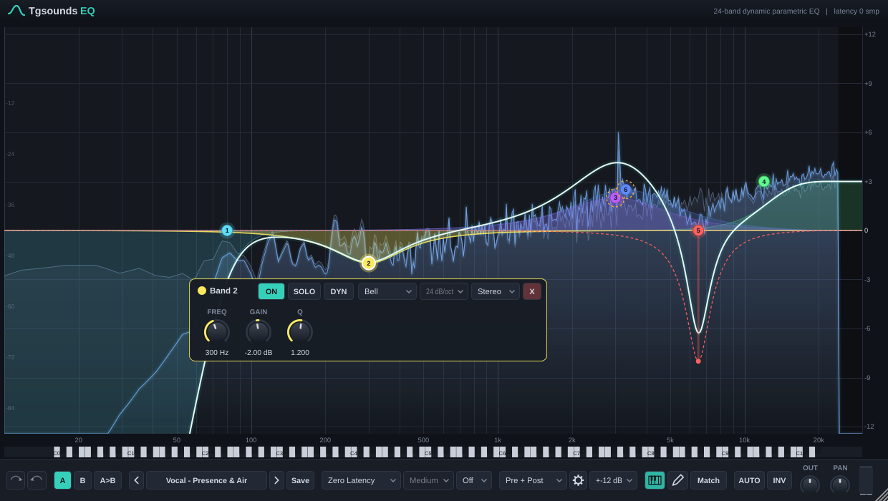

# Tboy Plugins

Audio plugins by Tgsounds. Each plugin lives in its own folder, with its own CMake project and README.

| Plugin | Description | Formats |
|---|---|---|
| [TgsoundsEQ](TgsoundsEQ/) | 24-band parametric / dynamic EQ with Zero Latency, Natural Phase and Linear Phase modes, spectrum analyzer, Match EQ and MIDI learn | VST3 · AU · Standalone |



## Building a plugin

```bash
git clone https://github.com/tboygray-droid/Tboy-plugins.git
```
```bash
cd Tboy-plugins/TgsoundsEQ
```
```bash
cmake -B build -DCMAKE_BUILD_TYPE=Release
```
```bash
cmake --build build --config Release
```

See each plugin's README for platform requirements, tests and architecture notes.
