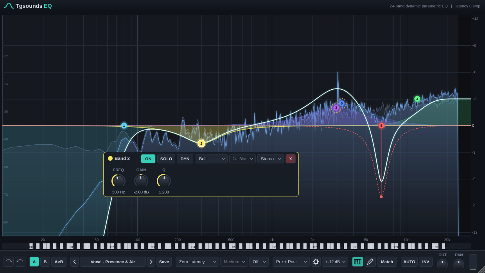

# TgsoundsEQ

A 24-band parametric / dynamic EQ plugin (VST3, AU, Standalone) built with JUCE 8 and modern C++20.
It takes its workflow from modern interactive EQs: a large response display, draggable nodes,
a floating band panel and a live spectrum analyzer. All code, artwork and branding are original.



## Features

| Area | What you get |
|---|---|
| Bands | 24 bands: Bell, Low/High Shelf, Low/High Cut, Notch, Band Pass, Tilt Shelf, Flat Tilt; 10 Hz to 30 kHz, ±30 dB, Q 0.025 to 40 |
| Slopes | Cuts: 6/12/18/24/36/48/72/96 dB/oct + Brickwall (cascaded Butterworth). Shelves: 6 dB/oct = 1st order, otherwise 2nd order |
| Stereo | Per-band Stereo / Left / Right / Mid / Side |
| Modes | **Zero Latency** (bilinear / RBJ), **Natural Phase** (matched-analog, cramp-free, still zero latency), **Linear Phase** (FIR; Low/Medium/High/Max) |
| Oversampling | Off / 2x / 4x (polyphase IIR) for the minimum-phase modes |
| Dynamics | Per band: threshold, range, ratio, attack, release, Gain Down / Gain Up, internal or external sidechain detection, band-limited detector |
| Analyzer | 4096 to 32768-point FFT (default 8192), Hann, 75 % overlap; Pre / Post / Pre+Post / Sidechain; range, speed, tilt (0 to 4.5 dB/oct), peak hold; gradient fill + glow; spectrum grab |
| GUI | Resizable, OpenGL, v-blank driven (60 fps); ±3/6/12/30 dB scales; piano overlay; draw-a-curve; collision warnings; solo (listen) |
| Workflow | Undo/Redo, A/B + copy, preset browser (22 factory presets + user presets), MIDI Learn on every parameter, Match EQ, auto gain, output gain/pan, polarity, meters |

## Building

TgsoundsEQ lives in the `TgsoundsEQ/` folder of the [Tboy-plugins](https://github.com/tboygray-droid/Tboy-plugins)
repository. Run all commands below from that folder:
```bash
git clone https://github.com/tboygray-droid/Tboy-plugins.git
```
```bash
cd Tboy-plugins/TgsoundsEQ
```

Requirements: CMake ≥ 3.22, a C++20 compiler (GCC 11+, Clang 14+, MSVC 2022, Xcode 14+), and Git.
JUCE 8.0.9 and Catch2 3.7.1 are fetched automatically by CMake (FetchContent).

### Linux
```bash
sudo apt install build-essential cmake ninja-build libasound2-dev libx11-dev libxrandr-dev \
  libxinerama-dev libxcursor-dev libxcomposite-dev libxext-dev libfreetype-dev \
  libfontconfig1-dev libgl1-mesa-dev
```
```bash
cmake -B build -G Ninja -DCMAKE_BUILD_TYPE=Release
```
```bash
cmake --build build -j
```

### macOS (VST3 + AU + Standalone)
```bash
cmake -B build -G Xcode
```
```bash
cmake --build build --config Release
```

### Windows
```bash
cmake -B build -G "Visual Studio 17 2022"
```
```bash
cmake --build build --config Release
```

Artefacts end up in `build/TgsoundsEQ_artefacts/<Config>/{VST3,AU,Standalone}`.

Options:
- `-DTG_BUILD_TESTS=OFF` skips the test target.
- `-DTG_ENABLE_LTO=ON` enables link-time optimisation for release builds.
- `-DFETCHCONTENT_SOURCE_DIR_JUCE=/path/to/JUCE` (and `..._CATCH2`) builds against local checkouts, offline.

## Tests

```bash
cmake --build build --target TgsoundsEQTests && ./build/TgsoundsEQTests
```
or `ctest --test-dir build`. GUI tests need a display; on headless Linux use `xvfb-run -a`.

| Suite | Checks |
|---|---|
| `[filters]` | Bilinear designs vs. the analytic (pre-warped) response, **within 0.1 dB** (actually ~1e-9) for every shape, slope and sample rate. Natural Phase vs. the true analog response: < 0.1 dB for bands up to fs/64, never worse than bilinear, and a 2.5x+ smaller worst case around fs/16 to fs/8 (measured 3-4x). Exact SVF ≡ biquad equivalence. Processed-sine gain vs. design (0.1 dB). Linear-phase FIR vs. analog (0.1 dB), symmetry. Slope steepness |
| `[stability]` `[denormals]` | Random parameter jumps every 8 ms in every mode, full-range resonant sweeps at 44.1/192 kHz, and 21 s of silence after an impulse with no subnormals |
| `[latency]` | Measured impulse delay == reported latency for every mode / quality / oversampling factor at 44.1/96/192 kHz; runtime mode changes; bypass compensation |
| `[state]` | Every parameter round-trips; garbage state is harmless; exact restore of booleans |
| `[realtime]` | A global `operator new` hook proves `processBlock` performs **zero allocations** in every mode (including during parameter changes, analyzer taps and MIDI) |
| `[dynamics]` `[sidechain]` | Range / ratio / threshold maths, gain up/down, band-limited detection, external sidechain, linear-phase dynamics |
| `[analyzer]` | Calibrated levels, tilt, peak hold, lock-free FIFO under concurrency |
| `[fit]` `[match]` `[presets]` `[midi]` `[gui]` | Curve fitter, Match EQ (also end-to-end through the analyzer), all factory presets, user presets, A/B, MIDI learn + persistence, GUI mouse interactions + undo |

Hidden helpers: `"[bench]"` prints CPU usage, `"[screenshot]"` renders the editor to PNGs, and `"[diag]"` prints filter error tables.

### pluginval
```bash
PLUGINVAL=/path/to/pluginval VST3_VALIDATOR=/path/to/validator tools/run-pluginval.sh 5
```
The plugin passes pluginval 1.0.4 at **strictness 5 and 10** (several random seeds), including the Steinberg
VST3 validator (47/47). `tools/run-pluginval.sh` contains a small shim, because pluginval 1.0.x passes the
inner `.so` to newer SDK validators, which only accept the bundle directory.

## Architecture

```
source/
  PluginProcessor.*      bus layouts, processBlock orchestration, latency, state, host programs
  PluginEditor.*         window layout, OpenGL, v-blank repaint, keyboard shortcuts
  params/                parameter IDs/enums/ranges, APVTS layout, cached atomics, snapping BoolParameter
  dsp/
    FilterDesign.*       analog prototypes -> bilinear or matched-analog biquads
    Svf.h                exact biquad -> TPT state-variable filter mapping + runtime
    EqBand.*             one band: smoothing, ramped coefficients, enable fades, dynamics
    IirEqEngine.*        24 bands in series, L/R <-> M/S switching per band
    PartitionedConvolver.*  UPOLS convolver, 2x2 FIR matrix, lock-free IR swap with crossfade
    LinearPhaseEngine.*  FIR design from the analog magnitude, latency bookkeeping
    EqDesigner.*         background thread: linear-phase IRs + auto-gain
    SoloFilter.h, DelayLine.h, OutputStage.h
  analyzer/              lock-free FIFOs, FFT analyzer thread, Match EQ capture
  fit/                   Levenberg-Marquardt curve fitter, Match EQ
  state/                 presets (factory + user), A/B, MIDI learn
  gui/                   look & feel, response display, band panel, bottom bar, match panel, meter
tests/                   Catch2 test suites (see above)
```

### Signal flow
```
in ──► MIDI-learn queue (CC only, lock-free)
   ├─► analyzer "pre" tap ─────────────────────────────────────────────────────┐
   ├─► [Zero Latency / Natural Phase]  oversample ► 24× EqBand (SVF) ► downsample
   │   [Linear Phase]  2×2 FIR convolver  +  min-phase "delta" bands for dynamics
   ├─► solo filter ► output stage (gain, auto-gain, pan, polarity)
   ├─► bypass crossfade against the latency-compensated dry signal
   └─► analyzer "post" tap + meters ─────────────────────────────────────────► GUI
```

### Key design decisions
- **One description, three discretisations.** Every shape is a cascade of analog 1st/2nd-order sections.
  Zero Latency pre-warps each section's corner (RBJ-equivalent). Natural Phase builds several candidates
  (impulse-invariant or magnitude-fitted poles × least-squares or 3-point numerators, plus bilinear). Each is
  scored against the analog magnitude, and the best realisable, minimum-phase one wins. Linear Phase samples the
  exact analog magnitude, so it never cramps.
- **Modulation-safe filters.** Every biquad is mapped exactly onto a Simper/Cytomic TPT state-variable filter.
  Coefficients are re-designed at a control rate (~1.5 kHz) and (g, k, m0..m2) are ramped per sample. A TPT SVF
  stays stable for any positive g and k, so fast automation can't blow it up (tested).
- **Stereo placement.** IIR bands run in order, and the buffer switches between L/R and M/S only when the next
  band needs it. In Linear Phase all bands collapse into one 2×2 FIR matrix (L/R and M/S combine exactly).
- **Latency.** Linear Phase uses `partition + taps/2`; oversampling uses the polyphase filters' integer latency.
  `computeRequiredLatency()` is shared by the DSP and the message-thread timer that calls `setLatencySamples`,
  so the host value always matches the audio (the latency test measures it). Bypass uses a matching dry delay.
- **Threads.** Audio thread: atomics + pre-allocated buffers only. Designer thread: FIR design and auto-gain,
  handed over through a two-slot atomic handshake. Analyzer thread: FFTs. Message thread: GUI, presets,
  MIDI-learn dispatch, host latency, and host program changes (deferred if they arrive on the audio thread).
- **Undo.** All GUI edits run inside parameter gestures. Transactions flush pending APVTS values first, so one
  edit can never leak into the next undo step.

## Using it

| Action | How |
|---|---|
| Add band | Double-click empty space (cuts at the extremes), or right-click to pick a shape |
| Move | Drag a node (frequency + gain; for cut shapes vertical = Q); hold **Shift** for 10x finer control |
| Q | Mouse wheel over a node (Shift = fine) |
| Delete | Alt-click a node, the X button, or Delete/Backspace |
| Shape / slope / placement / dynamic / solo | Right-click a node, or use the floating band panel |
| Enable/disable | Double-click a node, or ON in the panel |
| Spectrum grab | Hover a peak in the analyzer until "grab" appears, then drag |
| Draw a curve | Pencil button, sketch, release: bands are fitted automatically (Esc cancels) |
| Match EQ | **Match**: capture a reference (sidechain or input), capture the source, Apply |
| MIDI learn | Right-click any knob/combo/toggle → MIDI Learn, then move a controller |
| Reset a control | Double-click it |
| Undo/Redo | Buttons or Ctrl/Cmd+Z, Ctrl/Cmd+Shift+Z |

## Notes and limitations
- Natural Phase is a zero-latency minimum-phase design. For the most analog-accurate high bands, combine it with
  2x/4x oversampling: the remaining deviation shrinks with f0/fs (see `[diag]` and `[filters]`).
- In Linear Phase mode the static EQ is linear phase. The *dynamic* part of a dynamic band is applied as a
  minimum-phase correction (its detector is latency-aligned), like most linear-phase dynamic EQs.
- Slope applies to cuts and shelves. Bell / Notch / Band Pass are 2nd order.
- The summed response line shows all bands together, regardless of stereo placement.
- AU and macOS/Windows builds use the standard JUCE paths but were not built or validated as part of this
  project's CI (development and validation were done on Linux).

## License
TgsoundsEQ's own code is yours to license. JUCE is dual-licensed (AGPLv3 / commercial): check the
JUCE licence terms before distributing binaries.
